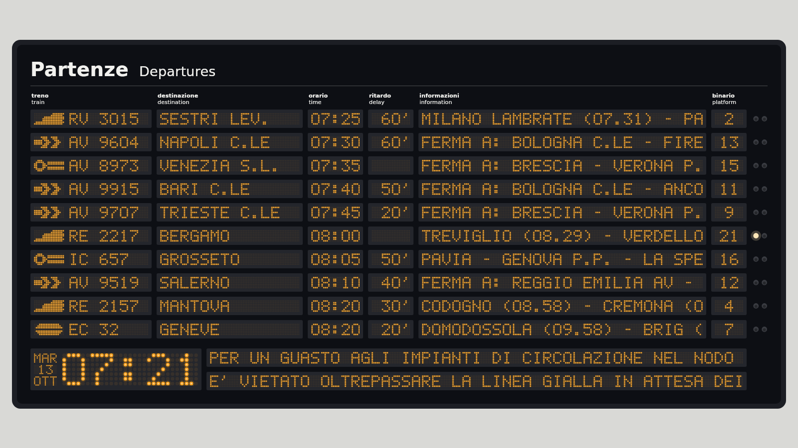
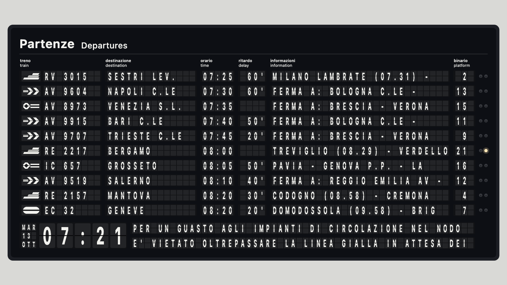

# Tabellone Partenze — Compose

Template di tabellone partenze in stile stazione italiana: moduli antracite, LED ambra a
matrice di punti 5×7, intestazioni bilingui, colonna informazioni a scorrimento, spie
lampeggianti, orologio e avvisi in basso.

Progetto Kotlin Multiplatform con tre target: **JVM** (desktop), **Android** e **wasmJs** (pagina
web).

| LED                                                                  | Palette                                                              |
|----------------------------------------------------------------------|----------------------------------------------------------------------|
|                |  |

## ⚠️ Disclaimer
Questa è solamente un app fan made, non c'è nessun intento di farla funzionare
come app ufficiale e neanche di venderla e farci soldi.

L'idea è di creare l'esperienza di essere in stazione con i ritardi annessi,
visto che un certo Ministro dei Trasporti non è in grado di prendersi [le sue responsabilità](https://www.ilfattoquotidiano.it/2026/07/08/caos-treni-salvini-ritardi-notizie/8443072/)


```bash
./gradlew run                                         # desktop: tabellone live dal monitor RFI
./gradlew run --args="--snapshot board.png 3 de"      # PNG headless dei dati demo dopo 3 s, etichette IT/DE (in composeApp/)
./gradlew run --args="--snapshot board.png 4 it flap" # lo stesso con le palette: parte vuoto e si riempie a 0,5 s
./gradlew run --args="--bench"                        # ms per frame del rendering (headless, 4K, scroll attivo)
./gradlew run --args="--bench 600 flap"               # lo stesso con le palette, che girano ogni 3 s
./gradlew run --args="--announce"                     # jingle + annuncio di esempio con la voce del sistema operativo
./gradlew run --args="--clatter 60"                   # crepitio di 60 palette che girano insieme
./gradlew run --args="--intro-snapshot intro.png 38.2" # PNG headless dell'intro d'avvio a 38,2 s
./gradlew run --args="--intro-snapshot intro.png 45.2 cruscotto" # ...con il tabellone che resta nel cruscotto
./gradlew :composeApp:packageUniversalJar            # jar desktop unico per Windows/macOS/Linux in composeApp/build/dist/
./gradlew :composeApp:jvmTest                         # parser RFI sulle pagine salvate, testi e logica degli annunci
./gradlew :androidApp:assembleDebug                   # APK in androidApp/build/outputs/apk/debug/
./gradlew :androidApp:installDebug                    # installa sul dispositivo/emulatore collegato
./gradlew :composeApp:wasmJsBrowserDevelopmentRun     # pagina web su http://localhost:8080 (con proxy RFI/Trenord)
./gradlew :composeApp:wasmJsBrowserDistribution       # pagina statica in composeApp/build/dist/wasmJs/productionExecutable/
```

## Build di rilascio

| Target  | Comando                                           | Risultato                                                                   |
|---------|---------------------------------------------------|-----------------------------------------------------------------------------|
| Android | `./gradlew :androidApp:assembleRelease`           | APK in `androidApp/build/outputs/apk/release/`                              |
| Android | `./gradlew :androidApp:bundleRelease`             | AAB per il Play Store in `androidApp/build/outputs/bundle/release/`         |
| Wear OS | `./gradlew :wearApp:assembleRelease`              | APK smartwatch in `wearApp/build/outputs/apk/release/`                      |
| Web     | `./gradlew :composeApp:wasmJsBrowserDistribution` | pagina statica in `composeApp/build/dist/wasmJs/productionExecutable/`      |
| Desktop | `./gradlew :composeApp:packageUniversalJar`       | `composeApp/build/dist/DepartureBoard-<versione>.jar` (Windows/macOS/Linux) |

**Android**: la release passa da R8 (`isMinifyEnabled`, `isShrinkResources`) ed è firmata con
`signing/DepartureBoardKeyStore.jks`. Le credenziali stanno in `signing/credential.properties`; la
cartella `signing/` è fuori da git:

```properties
storeFile=DepartureBoardKeyStore.jks
storePassword=…
keyAlias=…
keyPassword=…
```

`storeFile` è relativo a `signing/` (o un percorso assoluto). Se manca il file o uno dei quattro
valori la build riesce lo stesso, ma esce `androidApp-release-unsigned.apk`. La versione è `app-version` (versionName) e
`app-versionCode` in `gradle/libs.versions.toml`, la stessa del desktop e dell'immagine Docker.

**Web**: la cartella va servita con un proxy verso RFI e Trenord, come fa il container Docker
(vedi [Pagina web](#pagina-web-wasmjs)).

**Desktop**: un solo jar con ProGuard e le native di tutte le piattaforme, da lanciare con
`java -jar` (Java 21+); vedi [Desktop (Nucleus)](#desktop-nucleus). La versione è `app-version` in
`gradle/libs.versions.toml`.

## Release e CI

Le pipeline GitHub Actions sono scritte in Kotlin con
[github-workflows-kt](https://github.com/typesafegithub/github-workflows-kt): si modifica lo script
`.main.kts`, si rigenera il YAML e si committano entrambi (un job di ogni workflow rigenera il YAML e
fallisce se non coincide).

```bash
kotlin .github/workflows/ci.main.kts         # → .github/workflows/ci.yaml
kotlin .github/workflows/release.main.kts    # → .github/workflows/release.yaml
```

Gli script vanno lanciati dalla root del repository. La cache di `main.kts` si ricorda il percorso
della prima compilazione: se nel job `check_yaml_consistency` del YAML compare `release.main.kts`
senza `.github/workflows/`, rigenerare con `KOTLIN_MAIN_KTS_COMPILED_SCRIPTS_CACHE_DIR=` davanti.

| Workflow  | Quando              | Cosa fa                                                                                                      |
|-----------|---------------------|--------------------------------------------------------------------------------------------------------------|
| `CI`      | push su `main` e PR | `jvmTest` e test del watch, APK release telefono e watch (non firmati), jar universale, distribuzione wasmJs, build dell'immagine senza push |
| `Release` | push di un tag `v*` | GitHub Release con APK firmato e jar, immagine su ghcr.io                                                  |

Per pubblicare una versione si aggiorna `app-version` e si incrementa `app-versionCode` in
`gradle/libs.versions.toml`, poi:

```bash
git tag v1.2.0 && git push origin v1.2.0
```

Il tag deve corrispondere ad `app-version`, altrimenti la release si ferma. Con un suffisso
(`v1.2.0-rc.1`) esce una prerelease: Release marcata come tale e immagine col solo tag
`1.2.0-rc.1`.

- **GitHub Release**: `Tabellone-<versione>.apk`, `Tabellone-Wear-<versione>.apk` (smartwatch) e
  `DepartureBoard-<versione>.jar`, note generate dai commit.
- **Docker**: `ghcr.io/samuele794/tabellone-caronte` per `linux/amd64` e `linux/arm64`, con i tag
  `<versione>`, `<major>.<minor>` e `latest` e l'attestazione di provenienza della build.
  `docker run --rm -p 8080:8080 ghcr.io/samuele794/tabellone-caronte`.

Da configurare una volta sola nel repository GitHub (guida passo passo in
[docs/release](docs/release/README.md)):

- **Secret** (Settings → Secrets and variables → Actions): `ANDROID_KEYSTORE_BASE64`
  (`base64 -i signing/DepartureBoardKeyStore.jks`), `ANDROID_KEYSTORE_PASSWORD`, `ANDROID_KEY_ALIAS`,
  `ANDROID_KEY_PASSWORD`: gli stessi valori di `signing/credential.properties`, che il workflow
  ricrea in CI.
- **Package** ghcr.io: dopo la prima release, da Packages → `tabellone-caronte` → Package settings
  si può rendere pubblico.

## Moduli

| Modulo       | Contenuto                                                                                                                                                                   |
|--------------|-----------------------------------------------------------------------------------------------------------------------------------------------------------------------------|
| `composeApp` | Libreria KMP (`jvm()` + `android {}` + `wasmJs`): tutto il codice condiviso in `commonMain`, l'app desktop in `jvmMain`, la pagina web in `wasmJsMain`, i test in `jvmTest` |
| `androidApp` | App Android (`com.android.application`): `MainActivity`, che mostra `LiveBoard`, e il collegamento con lo smartwatch                                                        |
| `wearApp`    | App Wear OS (`com.android.application`, stesso `applicationId` del telefono): il treno seguito, tile e complication; vedi [Smartwatch](#smartwatch-wear-os)                |

Con AGP 9 il plugin `com.android.application` non si combina più con `kotlin.multiplatform`,
per questo l'app Android è un modulo a parte che dipende da `composeApp`. Versioni in
`gradle/libs.versions.toml`; `compileSdk` 37 è il minimo richiesto da Compose 1.12.

| Source set    | Engine Ktor |
|---------------|-------------|
| `jvmMain`     | CIO         |
| `androidMain` | OkHttp      |
| `wasmJsMain`  | Js (fetch)  |

`RfiClient()` crea l'`HttpClient` senza indicare l'engine: lo sceglie la piattaforma.

## Uso

```kotlin
DepartureBoard(
    departures = listOf(
        Departure(
            category = "AV", number = "9915", destination = "BARI C.LE",
            time = "07:40", delayMinutes = 50,
            info = "FERMA A: BOLOGNA C.LE - ANCONA - PESCARA C.LE",
            platform = "11",
            logo = imageResource(Res.drawable.logo_operatore),   // PNG trasparente
            lamps = Lamps.Blinking,
        ),
    ),
    footer = BoardFooter("07:21", listOf("MAR", "13", "OTT"), listOf("AVVISO…")),
    labels = BoardLabels(),               // oppure BoardLabels.ItalianGerman / BoardLabels.Arrivals
    layout = BoardLayout(infoChars = 28, rows = 10),
    modifier = Modifier.fillMaxWidth(),
)
```

Il tabellone calcola da solo il passo dei LED dalla larghezza disponibile. Con `BoardLayout(rows = null)`
occupa tutta l'altezza disponibile e mostra quante righe ci stanno; se le partenze sono di più,
la colonna delle righe scorre lentamente fino in fondo e torna su alla stessa velocità
(`scrollRowsPerSecond`, sosta agli estremi `scrollPauseMillis`). Si può sempre scorrere anche a
mano: l'automatico riprende `scrollResumeMillis` dopo l'ultimo scroll, nella stessa direzione.
Con `autoScroll = false` si scorre solo a mano.

## Prima colonna (logo)

`DotMatrixImage` converte qualsiasi `ImageBitmap` in LED ambra: riduce l'immagine a 7 righe
di punti e accende quelli coperti dal logo. `logoSampling` sceglie cosa conta come "pieno":
`Alpha` (PNG trasparente, default), `Luminance` (logo chiaro su fondo scuro), `Darkness`
(logo scuro su fondo bianco). I margini vuoti attorno al disegno vengono tagliati prima della
riduzione; `logoThreshold` abbassa la copertura minima per i marchi a tratto sottile e
`BoardLayout.logoDensity` usa più LED per punto nella colonna del logo. I marchi in `SampleLogos` sono inventati: sostituiscili con i
loghi che hai il diritto di usare.

## Tabellone a palette

Dalle impostazioni (**Aspetto**: **LED** / **Palette**) il tabellone passa allo stile Solari:
palette antracite con lettere bianche, una per carattere, nelle stesse colonne del LED
(`DepartureBoard(style = BoardStyle.SplitFlap)`). Quando un testo cambia ogni palette gira in
avanti sul suo tamburo (`FlapDrum`: spazio, A–Z, cifre, punteggiatura; le cifre tra loro hanno un
tamburo a parte, così 9 → 0 è un giro solo), una girata ogni 55 ms e partenze sfasate di qualche
decimo. Alla prima composizione (avvio, rotazione) il testo compare fermo.

Le palette non scorrono: dove i LED fanno il marquee (informazioni, destinazioni lunghe, avvisi)
il testo si divide in pagine (`flapPages`, a capo tra le parole). Ogni pagina resta ferma per la
**Pausa tra le pagine** scelta nelle impostazioni (da 2 a 30 s, predefinita 5 s, doppia in
modalità risparmio; `BoardLayout.flapPageMillis`), contata da quando l'ultima palette si è posata,
poi la colonna gira alla pagina dopo; un testo nuovo riparte dalla prima pagina. Lo scorrimento
verticale delle
righe resta quello del LED. L'orologio ha i ":" fissi; il logo dell'impresa è stampato in bianco
su una palette sola (`FlapLogo`) e gira una volta quando cambia.

Il crepitio usa colpi di palette veri: 24 colpi da 30 ms ritagliati da
[Split Flap Display](https://freesound.org/s/261244/) di ngruber (CC0) e salvati in
`composeResources/files/flap-clicks.wav` (PCM mono 16 bit a 44,1 kHz, un colpo ogni 30 ms).
`FlapClatter.kt` mette un colpo a caso nell'istante in cui ogni palette cade, con volume e
velocità un po' diversi (±6%); le girate partite nello stesso aggiornamento finiscono in
un'unica traccia PCM. Più palette suonano più forte, ma la somma passa da un soft-clip e oltre
30 colpi ogni 10 ms il crepitio è già saturo. Si spegne con **Suono delle palette** e si regola
con **Volume delle palette** (10–100%, a scatti di 10; `FlapClatter.volume`): il guadagno è il
quadrato del cursore, così metà cursore suona a circa metà forza percepita, e al rilascio parte un
breve crepitio di prova. Mentre si diffonde un annuncio (jingle compreso, `Announcer.speaking`) il
crepitio scende al 20% del cursore, o resta dov'è se è già più basso
(`FlapClatter.DUCKED_VOLUME`): il guadagno è uno `StateFlow` che i player seguono anche a
crepitio iniziato, quindi si abbassa anche quello partito prima dell'annuncio. Per cambiare
suono basta sostituire la WAV con altri colpi nello stesso formato (`FlapClicks.fromWav`).

| `tts.PcmPlayer` | Implementazione                                                                                   |
|-----------------|---------------------------------------------------------------------------------------------------|
| JVM             | `JvmPcmPlayer`: una `SourceDataLine` di `javax.sound` per riproduzione, guadagno in rampa a pezzi |
| Android         | `AndroidPcmPlayer`: `AudioTrack` statico, guadagno con `setVolume`                                |
| wasmJs          | `WebPcmPlayer`: Web Audio API con un `GainNode`, attivata al primo gesto come gli annunci         |

## Sottofondo di stazione

Mentre il tabellone è visibile suona in loop l'ambiente di Milano Centrale,
`composeResources/files/milano-central-background.mp3` (20 minuti, MP3 mono a 96 kbps). Si spegne
con **Sottofondo di stazione** e si regola con **Volume del sottofondo** (10–100%, a scatti di 10,
predefinito 50%; `BackgroundSound.volume`). Come per le palette il guadagno è il quadrato del
cursore e si segue anche a sottofondo in corso. Durante un annuncio si abbassa a poco a poco:
comincia
a scendere quando si sente il jingle (`Announcer.started`) e arriva al 5% del cursore
(`BackgroundSound.DUCKED_VOLUME`) proprio alla fine del jingle, di cui si conosce la durata contando
i frame dell'MP3 (`tts.mp3Duration`); resta lì mentre parla la voce e a fine annuncio risale al
volume scelto in 3 s (`BackgroundSound.RESTORE_DURATION`). Senza jingle scende in mezzo secondo. Una
rampa nuova parte sempre da dove era arrivata la precedente, così un annuncio interrotto o uno
subito dopo l'altro non fanno salti. Con l'app in secondo piano tace, come gli aggiornamenti.

Di notte, dall'1:00 alle 5:00 (ora locale del dispositivo), il sottofondo tace qualunque cosa dicano
le impostazioni (`BackgroundSound.playOutsideQuietHours`): all'1:00 sfuma in 10 s e si ferma, alle
5:00 riparte da muto e sale al volume scelto in 10 s (`BackgroundSound.FADE`). Avviato fuori da
quelle ore parte subito al volume pieno. L'ora si ricontrolla almeno una volta al minuto, così il
cambio dell'ora legale o una sospensione del computer non spostano l'orario di più di tanto.

| `tts.LoopPlayer` | Implementazione                                                                                        |
|------------------|--------------------------------------------------------------------------------------------------------|
| JVM              | `JvmLoopPlayer`: JLayer letto a pezzi dalla risorsa, riaperta a ogni giro                              |
| Android          | `AndroidLoopPlayer`: `MediaPlayer` con `isLooping`, direttamente dagli asset dell'APK                  |
| wasmJs           | `WebLoopPlayer`: `<audio loop>` che punta alla risorsa; se il browser lo blocca riparte al primo gesto |

## Intro d'avvio

A ogni avvio, sopra il tabellone, parte un'intro di 45,3 s (`intro/IntroHost`): la sala circolazione
si collega alla stazione scelta. Dura quanto la sua musica, `composeResources/files/intro.mp3`, e
la grafica segue l'audio da quando comincia a sentirsi. Le battute sono in `intro/IntroTimeline`:

| Da      | Fase      | Contenuto                                                                                                                                                                               |
|---------|-----------|-----------------------------------------------------------------------------------------------------------------------------------------------------------------------------------------|
| 0 s     | Terminale | Console che si autentica, prova due stazioni sbagliate e si collega a quella del tabellone; registro, SISTEMA, CONFIG (le impostazioni vere) e il logo FS a punti che gira sullo sfondo |
| 37,5 s  | Stacco    | Il terminale si spezza in bande che tremano e spariscono                                                                                                                                |
| 37,85 s | Cruscotto | Il tabellone vero, rimpicciolito, tra logo, orologio di stazione, schema binari, prossimo treno e avvisi                                                                                |
| 41,25 s | Banner    | "TABELLONE ATTIVATO" tra fasce verde opale e rosso FS, sfondo sfocato                                                                                                                   |
| 44 s    | Zoom      | I pannelli escono di lato e il tabellone si allarga a tutto schermo                                                                                                                     |

Il tabellone sta sotto l'intro dall'inizio (`introBoardLayer` lo sposta con un `graphicsLayer`):
intanto scarica i treni, e alla fine è già quello vero. Durante l'intro sottofondo, palette e
annunci
tacciono (`LiveBoardState.introPlaying`, come `muted`). Si salta solo col pulsante **SKIP** in fondo
alla barra in alto del terminale (compare dopo 0,6 s); tocchi e tasti altrove non fanno nulla. Con
l'app in secondo piano finisce lì. Si spegne con **Intro all'avvio**; gira muta
con l'audio silenziato e nelle ore di quiete del sottofondo. Su Android una rotazione non la fa
ripartire; sul web aspetta il primo gesto, senza il quale il browser non suonerebbe. Con
**Tabellone nel cruscotto** il tabellone non si allarga alla fine: resta nel cruscotto, con dati e
ora veri, anche quando l'intro è saltata o spenta. Il terminale
usa Share Tech Mono (OFL, `files/licenses/ShareTechMono-OFL.txt`).

## Dati live (RFI)

`./gradlew run` apre il tabellone collegato a
[iechub.rfi.it](https://iechub.rfi.it/arrivipartenze) a tutto schermo. La rotella in alto a destra
apre le impostazioni, una pagina al posto del tabellone. In quella principale ci sono la stazione
(un dialog con ricerca sulle circa 2400 località del menu `ElencoLocalita`), **Partenze**/
**Arrivi**, più il menu delle altre pagine:
**Audio** (annunci, sottofondo, palette e i loro volumi), **Aspetto e risparmio energetico** (LED o
palette, scorrimento automatico, intro, cruscotto, modalità risparmio, fondo nero, schermo acceso),
**Smartwatch** e **Aggiornamento** (ogni quanto si rilegge il tabellone, per fornitore). Indietro,
con la freccia o con il gesto di sistema (predittivo su Android), torna alla pagina principale e da
lì al tabellone. La navigazione usa Navigation 3 (`NavDisplay`): il tabellone è la radice del back
stack, le pagine delle impostazioni gli si impilano sopra. La pagina
`ArrivalsDepartures/Monitor?placeId=…&arrivals=…` viene riletta ogni 30 s; l'ora dell'ultimo
aggiornamento compare accanto alla rotella e la stazione nella seconda riga della fascia
inferiore. Se la rete manca restano gli ultimi dati e l'errore compare nelle impostazioni.

Il package `rfi` usa solo Ktor e Ksoup (niente `java.*`) e sta in `commonMain`:

| File | Contenuto |
|---|---|
| `RfiClient.kt` | Scarica elenco stazioni e monitor (`baseUrl` configurabile: dal browser serve un proxy, RFI non manda intestazioni CORS) |
| `RfiParser.kt` | HTML → `RfiBoard`/`Station`; scarta le righe vuote di riempimento |
| `RfiMapper.kt` | `RfiTrain` → `Departure`: sigle di categoria, logo GIF del vettore decodificato e in cache |

Colonne lette da ogni `<tr>`: `RVettore` (logo), `RCategoria`, `RTreno`, `RStazione`
(destinazione o provenienza), `ROrario`, `RRitardo`, `RBinario`, `RExLampeggio` (spie),
`RDettagli` (fermate e, dopo, le note del blocco "Informazioni", nella colonna informazioni). Gli
avvisi di stazione finiscono nella fascia
inferiore. I loghi RFI sono GIF su fondo trasparente con scritte molto larghe (TRENORD è 11:1):
il tabellone live li disegna su una matrice 3× più fitta (`BoardLayout.logoDensity`,
`RfiMapper.LOGO_DENSITY`) in una colonna di 24 punti, con una soglia più bassa
(`RfiMapper.LOGO_THRESHOLD`).

## Dati live (FNM / Trenord)

Nel dialog della stazione le schede **RFI** / **FNM** scelgono il fornitore: scegliendo una
stazione dell'altra scheda si cambia anche fornitore. Entrambi implementano `live.BoardSource` e
restituiscono righe `RfiTrain`, così tabellone e annunci sono gli stessi. Le stazioni FNM
(codice MIR, es. `S01067`) vengono da `/mia/v2/stazioni_v2/`, senza le voci "(tutte le stazioni)".

| Dato                                                                                 | Endpoint trenord.it                                               | Ogni                                  |
|--------------------------------------------------------------------------------------|-------------------------------------------------------------------|---------------------------------------|
| Treni della stazione (solo orario programmato)                                       | `/rest/render/station-details?mirCode=…`: HTML dentro JSON, lento | 5 min (`FnmBoardSource.LIST_REFRESH`) |
| Dettaglio dei primi 15 treni (`MAX_TRAINS`): binario, ritardo, soppressione, fermate | `/mia/bff/train/{numero}?date=…`: JSON cifrato AES-256-ECB        | 30 s                                  |
| Dettaglio di ripiego, senza binari                                                   | `/rest/render/train-sub-detail?trainId=…`                         | se il BFF fallisce                    |

La chiave del BFF è lo SHA-256 di una frase scritta nel JavaScript del sito. Se cambia,
`FnmKeyStore` riscarica `trenord-web-components.js` (al più ogni 10 minuti), prende i letterali
passati a `generateKey`, tiene quello che decifra la risposta e lo salva in `fnm-key.json`
(accanto a `stations.json`). Se nemmeno così si decifra, si passa all'HTML.

L'elenco toglie i treni all'orario programmato: quelli in ritardo restano finché il dettaglio
non li dà per partiti. Accanto alla rotella ci sono due conti alla rovescia: dettagli ed elenco.

## Annunci sonori

A ogni aggiornamento il tabellone confronta la pagina appena scaricata con la precedente e
annuncia a voce le novità, con le formule del *Manuale degli Annunci Sonori* RFI (MAS),
precedute dal jingle `composeResources/files/trenitalia-station-anouncements.mp3`. Il primo
tabellone dopo l'avvio o dopo un cambio di stazione o di Partenze/Arrivi fa solo da base: non
annuncia nulla. Gli annunci si spengono dalle impostazioni (**Annunci sonori**).

| Variazione tra due aggiornamenti                    | Partenze     | Arrivi |
|-----------------------------------------------------|--------------|--------|
| Si accendono le spie (in partenza / in arrivo)      | P1 (P16 bus) | A1     |
| … con binario diverso da quello mostrato prima      | P2           | A2     |
| Compare il binario (prima non c'era)                | P8           | A4     |
| Binario cambiato prima della partenza / dell'arrivo | P8           | A4     |
| Ritardo ≥ 10' (di nuovo se varia di almeno 5')      | P5           | A3     |
| Treno soppresso                                     | P9           | A5     |

Il delta confronta solo i treni presenti in entrambe le versioni: un treno appena comparso entra
nella base così com'è (anche se ha già ritardo o spie accese) e uno sparito non si annuncia.

Per il debug ci sono due tag di log (`debuglog.DebugLog`, spegnibile con
`DebugLog.enabled = false`):
su desktop finiscono nello standard output, su Android in logcat (
`adb logcat -s Tabellone Annunci`).

```
[Tabellone] Delta MILANO CENTRALE · partenze: treni confrontati 14, annunci 1 (esclusi: comparsi 1, spariti 1)
[Tabellone]   AV 9915 BARI C.LE 07:40: binario '' → '11'  ⇒ P8
[Tabellone]   R 2061 BRESCIA 07:45: ritardo 3 → 6  ⇒ nessun annuncio
[Annunci] In coda P8 AV 9915 BARI C.LE 07:40: Informiamo i viaggiatori che il treno …
[Annunci] Diffondo P8 AV 9915 BARI C.LE 07:40: Informiamo i viaggiatori che il treno …
[Annunci] Finito P8 AV 9915 BARI C.LE 07:40
```

`Tabellone` mostra per ogni aggiornamento i campi cambiati (binario, ritardo, spie, soppressione,
orario, località) e la decisione; `Annunci` segue la coda: accodato, diffuso, finito,
interrotto o scartato (cambio stazione, annunci spenti) ed eventuali errori dei motori.

Come si leggono i dati del monitor:

- **Treno**: CATEGORIA NUMERO di IMPRESA FERROVIARIA, come nel MAS. Il numero segue le regole
  del manuale (84 "ottantaquattro", 753 "sette cinque tre", 9448 "novantaquattro quarantotto",
  12156 "dodici uno cinque sei"). Le sigle RFI si sciolgono (RV → Regionale Veloce,
  RE → RegioExpress, S5 → Suburbano esse cinque; le altre si compitano: FM3 → "effe emme tre").
  RFI mette spesso il marchio al posto dell'impresa: Frecciarossa, Frecciargento, Frecciabianca,
  Intercity e Leonardo Express diventano "di Trenitalia", NTV "di Italo".
- **Binari**: in lettere, con i suffissi del monitor (11TR → "undici tronco", 1-OVEST → "uno
  ovest", 1 SOT → "uno sotterraneo", 20B → "venti bi").
- **Località**: le abbreviazioni delle fermate (`CASTIGL.FIORENT.`, `MI.P.GARIBALDI`,
  `LA SPEZIA C.`) si sciolgono confrontandole con l'elenco delle ~2400 località RFI, che l'app
  scarica già (`PlaceNames`). Ogni parola abbreviata dev'essere l'inizio della parola
  corrispondente, e un nome scritto per intero non viene allungato. Senza elenco valgono solo le
  regole fisse di `SpokenItalian` (C.LE, sigle di città come MI/VE/PA, S. → San/Santa/Sant'/Santo,
  P. → Porta, accenti scritti come apostrofo: SANTHIA' → Santhià).
- **Note** (blocco "Informazioni" del monitor; sul tabellone seguono le fermate nella stessa
  colonna): "VIA …" diventa la relazione di percorrenza dopo la destinazione ("per Bergamo, via
  Villapizzone e Milano Lambrate"), "NO-STOP" diventa "Non sono previste fermate intermedie",
  "PRIMA CLASSE IN TESTA" / "CARROZZA 1 IN CODA AL TRENO" seguono le formule della composizione
  del treno dell'appendice MAS ("La prima classe è in testa al treno"). Le altre note si leggono
  come frasi a sé, con numeri e orari in lettere. Come nel MAS, la composizione si legge negli
  annunci di partenza e di arrivo (P1/P2, A1/A2), "via …" in tutti quelli di partenza.

Il monitor non fornisce motivi dei ritardi, treni alternativi o fermate straordinarie: quelle
parti facoltative degli annunci vengono omesse. La soppressione si riconosce da "Cancellato"
nella cella del ritardo (o "soppresso" nelle note).

Il motore vocale è dietro due interfacce nel package `tts` di `commonMain`, così si può sostituire
per
piattaforma passando a `Announcer` altre implementazioni:

| Interfaccia    | JVM (`jvmMain`)                                                                                               | Android (`androidMain`)               |
|----------------|---------------------------------------------------------------------------------------------------------------|---------------------------------------|
| `SpeechEngine` | `DesktopSpeechEngine`: `say` (macOS), `System.Speech` via PowerShell (Windows), `espeak-ng`/`spd-say` (Linux) | `AndroidSpeechEngine`: `TextToSpeech` |
| `SoundPlayer`  | `JvmSoundPlayer`: JLayer (`javax.sound` non legge gli MP3)                                                    | `AndroidSoundPlayer`: `MediaPlayer`   |

Serve una voce italiana installata: su macOS Alice/Eddy/Federica (la prima `it_IT` di
`say -v ?`), su Windows una voce it-IT, su Linux il pacchetto `espeak-ng`, su Android i dati
vocali italiani del motore TTS di sistema.

Su Android, se il motore non inizia a parlare entro 15 s, `AndroidSpeechEngine` ricrea
`TextToSpeech` e passa a una voce italiana di rete; l'annuncio fallito non blocca la coda.
Serve sull'emulatore arm64 (Apple Silicon), dove il motore Google va in crash nativo
(`SIGILL` in TensorFlow Lite/XNNPACK) quando sintetizza in locale: il jingle suona, la voce no.
Anche la voce di rete ripiega sulla sintesi locale se il server non risponde in tempo, quindi
sull'emulatore qualche annuncio può ancora saltare; sui dispositivi reali la voce locale funziona.
Diagnosi: `adb logcat -s AndroidTts Annunci libc`.

| File (`commonMain`, `announce/`) | Contenuto                                                                          |
|----------------------------------|------------------------------------------------------------------------------------|
| `BoardAnnouncements.kt`          | Delta tra due tabelloni → elenco di `Announcement`                                 |
| `Announcement.kt`                | Tipi di annuncio con il codice MAS                                                 |
| `AnnouncementText.kt`            | Testo degli annunci secondo le formule del MAS                                     |
| `SpokenItalian.kt`               | Numeri, orari, binari, località, categorie, imprese e note da leggere ad alta voce |
| `PlaceNames.kt`                  | Abbreviazioni delle località sciolte con l'elenco delle stazioni RFI               |
| `Announcer.kt`                   | Coda: jingle e poi voce, un annuncio alla volta; `clear()` al cambio stazione      |

## Smartwatch (Wear OS)

Sul watch non c'è il tabellone intero ma **un solo treno**, con la disposizione del monitor di
binario di Bologna: binario e orologio a sinistra, destinazione e partenza al centro, impresa e
numero a destra, informazioni che scorrono in basso; etichette solo in italiano, pannello nero. Il
treno si sceglie sul telefono, in Impostazioni →
**Smartwatch**: prima la stazione (indipendente da quella del tabellone), poi uno dei treni in
partenza. Si segue il **numero**, ogni giorno: quando il treno non è sul monitor il watch mostra
"in attesa" con l'ultimo orario visto.

| Sul watch     | Cosa mostra                                                                               |
|---------------|-------------------------------------------------------------------------------------------|
| App           | treno (logo, categoria, numero, spia "in partenza"), destinazione, partenza e ritardo, binario, informazioni, età del dato |
| Tile          | destinazione, orario e ritardo, binario                                                   |
| Complication  | breve: orario e `+5'` / `OK` / `CANC`; lunga: `R 91831 VIGNOLA 19:18 +5' BIN 7`           |

I dati arrivano in modo **ibrido**, perché non tutti i watch hanno connettività propria:

1. **Dal telefono** (Wearable Data Layer): il watch manda `/watch/refresh`, il telefono legge il
   monitor e risponde con il DataItem `/watch/train`. Funziona anche ad app telefono chiusa
   (`WatchListenerService`); il telefono non fa nulla se il watch non lo chiede.
2. **Dal watch**, solo se il telefono non è raggiungibile e il watch ha **davvero** internet: chiede
   una rete Wi-Fi/LTE, la vuole validata dal sistema e senza portale di accesso, e prima di scaricare
   fa una richiesta di prova al fornitore (`WatchNetwork`). Il download usa la stessa rete.
3. **Senza nessuna delle due** resta l'ultimo dato, con "N min fa · senza rete" (o "senza
   internet").

Per la batteria si aggiorna solo attorno alla partenza (da 90 minuti prima a 20 dopo), più spesso
man mano che il treno si avvicina; in background solo se c'è un tile o una complication. Tutte le
regole, con gli intervalli, sono in [docs/smartwatch.md](docs/Smartwatch.md).

Telefono e watch devono avere lo stesso `applicationId` (`com.takaotech.departureboard`) e la stessa
firma: `wearApp` legge le stesse credenziali di `signing/credential.properties`. Il `versionCode` del
watch è quello del telefono più 10000. Per provarlo: un emulatore telefono e uno Wear OS abbinati
(Device Manager → *Pair Wearable*), poi `./gradlew :androidApp:installDebug :wearApp:installDebug`.

## Desktop (Nucleus)

L'app desktop usa [Nucleus](https://nucleusframework.dev) sopra Compose Desktop: il plugin
`dev.nucleusframework` sostituisce `compose.desktop.application` con `nucleus.application`, e
`Main.kt` apre la finestra con `nucleusApplication(args, backend = NucleusBackend.Tao)` e
`DecoratedWindow`. Tao è il backend nativo senza AWT, con istanza singola: un secondo avvio porta
in primo piano la finestra già aperta. Tao non disegna la cornice di sistema, quindi la barra del
titolo è una `TitleBar` dentro `WindowScaffold`: si trascina, col doppio clic massimizza e porta i
pulsanti della finestra (semafori su macOS, controlli disegnati su Windows e Linux). `--snapshot`,
`--bench`, `--announce` e `--clatter` girano
prima di `nucleusApplication` e non aprono finestre.

La distribuzione è un unico jar per Windows, macOS e Linux, x64 e arm64:

```bash
./gradlew :composeApp:packageUniversalJar
java -jar composeApp/build/dist/DepartureBoard-1.1.0.jar     # serve Java 21 o successivo
java -jar composeApp/build/dist/DepartureBoard-1.1.0.jar --announce
```

- **Native**: `jvmMain` dipende dalle native Skiko delle sei piattaforme (
  `compose.desktop.macos_arm64`
  e le altre al posto di `currentOs`); quelle di Nucleus sono già tutte dentro i suoi jar. All'avvio
  si carica quella del sistema in uso.
- **ProGuard**: il jar parte da `packageReleaseUberJarForCurrentOS` (ottimizzato, non offuscato:
  Skiko e Nucleus chiamano il codice Kotlin da JNI). Le regole sono in
  `composeApp/proguard-desktop.pro`: engine Ktor via `ServiceLoader`, `kotlinx.serialization`, JNI,
  JLayer, e niente specializzazione dei tipi di ritorno, che rompe le facciate Kotlin multi-file
  (`VerifyError: Bad return type`).
- **Manifest**: `packageUniversalJar` riscrive l'uber jar col nome senza OS e con
  `Enable-Native-Access: ALL-UNNAMED`, che toglie l'avviso di JNI di Java 22+.
- La versione desktop è `app-version` in `gradle/libs.versions.toml`. I dati restano in
  `~/.departure-board`. Sul jar non agiscono né Gatekeeper né SmartScreen, quindi non serve firma.

## Pagina web (wasmJs)

`Main.kt` di `wasmJsMain` monta `LiveBoard` con `ComposeViewport`. Serve un browser con
WasmGC (Firefox 120+, Chrome 119+, Safari 18.2+). Differenze rispetto a desktop e Android:

- **Proxy CORS**: RFI e Trenord non mandano intestazioni CORS, quindi i client usano
  `<proxy>/rfi` e `<proxy>/trenord`. Il proxy è indicato da `<meta name="board-proxy">` in
  `wasmJsMain/resources/index.html`; vuoto = la stessa origine della pagina. In sviluppo lo fa il
  dev server webpack (`composeApp/webpack.config.d/proxy.js`), che aggiunge anche lo User-Agent
  (dal browser non si può impostare: i client ricevono `userAgent = null`).
- **Salvataggi**: impostazioni, cache stazioni e chiave Trenord passano sempre da DataStore, ma
  su `localStorage` (`cache/JsonStorage.wasmJs.kt`) invece che su file.
- **Chiave Trenord**: WebCrypto non ha AES-ECB, quindi la decifratura usa `fnm/PureCrypto.kt`
  (AES-256 e SHA-256 in Kotlin puro, confrontati con JCA in `PureCryptoTest`).
- **Annunci, palette e sottofondo**: Web Speech API (`WebSpeechEngine`), `<audio>`
  (`WebSoundPlayer`, `WebLoopPlayer`) e Web Audio (`WebPcmPlayer`). Il browser li blocca fino al
  primo gesto dell'utente: finché non si tocca la pagina compare un avviso in alto, il crepitio
  delle palette si scarta e il sottofondo parte al primo tocco.
- **Fusi orari**: `kotlinx-datetime` li prende dal pacchetto npm `@js-joda/timezone`.
- Niente luminosità ridotta in modalità eco e niente stato di carica (`charging = null`).

### Container Docker

```bash
docker build -t departure-board-web .
docker run --rm -p 8080:8080 departure-board-web     # http://localhost:8080
```

Le immagini già pronte stanno su `ghcr.io/samuele794/tabellone-caronte` (vedi
[Release e CI](#release-e-ci)).

Il `Dockerfile` compila la distribuzione wasmJs con Gradle in un'immagine JDK 21 (l'Android SDK
non serve) e la copia in `nginxinc/nginx-unprivileged`, che ascolta sulla 8080 senza root.
`docker/nginx.conf` serve i file statici (`application/wasm`, cache lunga per i `.wasm` con
l'hash nel nome) e inoltra `/rfi/*` e `/trenord/*` come il dev server, con lo User-Agent di un
browser desktop: la pagina chiama tutto sulla stessa origine, quindi niente CORS. La build
Gradle usa fino a 4 GB di heap (`gradle.properties`): a Docker deve restare memoria sufficiente.

## File

Tutto il codice sta nel package `com.takaotech.departureboard` e nei suoi sottopackage (`announce`,
`cache`, `debuglog`, `fnm`, `live`, `rfi`, `tts`, `watch`, `android`, `wear`): i percorsi e i nomi di package di
questo
README sono relativi a `kotlin/com/takaotech/departureboard/` di ogni source set. Le risorse Compose
generano `com.takaotech.departureboard.resources.Res`, la classe principale del desktop è
`com.takaotech.departureboard.MainKt`.

Nel package radice, in `composeApp/src/commonMain`:

| File                | Contenuto                                                               |
|---------------------|-------------------------------------------------------------------------|
| `DotMatrixFont.kt`  | Font 5×7 disegnato a mano (A–Z, 0–9, punteggiatura, accenti come `E'`)  |
| `DotMatrixText.kt`  | Testo LED a larghezza fissa, allineamento, marquee a scatti di un punto |
| `DotMatrixImage.kt` | Immagine → matrice di LED                                               |
| `DepartureBoard.kt` | Modello dati, layout del tabellone, spie, fascia inferiore              |
| `BoardTheme.kt`     | Colori e disegno dei singoli LED (alone + nucleo) e delle palette       |
| `BoardStyle.kt`     | LED o palette                                                           |
| `FlapDrum.kt`       | Tamburo delle palette e divisione in pagine dei testi lunghi            |
| `SplitFlapText.kt`  | Palette di testo e logo: animazione della girata, facce pre-disegnate   |
| `FlapClatter.kt`    | Crepitio delle palette: colpi registrati mixati sulle girate            |
| `SampleData.kt`     | Loghi e partenze dimostrative                                           |

Nel package `intro`, in `composeApp/src/commonMain`:

| File                 | Contenuto                                                           |
|----------------------|---------------------------------------------------------------------|
| `IntroTimeline.kt`   | Tempi delle fasi e copione della console (funzioni pure, testate)   |
| `Intro.kt`           | `IntroHost` (audio, orologio, skip), `IntroOverlay`, stacco a bande |
| `TerminalScreen.kt`  | Terminale della sala circolazione                                   |
| `DashboardScreen.kt` | Geometria e pannelli del cruscotto attorno al tabellone             |
| `IntroBanner.kt`     | Banner "TABELLONE ATTIVATO"                                         |
| `FsLogo.kt`          | Logo FS dai path dello SVG, pieno o a punti che girano              |
| `IntroInfo.kt`       | Dati del tabellone mostrati dall'intro, ora e prossima partenza     |
| `IntroStyle.kt`      | Colori, font, unità di misura, rumore deterministico                |

Applicazione:

| Source set                  | File                           | Contenuto                                                                                                                         |
|-----------------------------|--------------------------------|-----------------------------------------------------------------------------------------------------------------------------------|
| `composeApp/src/commonMain` | `live/LiveBoard.kt`            | Stato e UI del tabellone live: refresh, orologio (`kotlinx-datetime`)                                                             |
| `composeApp/src/commonMain` | `live/Settings.kt`             | Pagine delle impostazioni (principale, Audio, Aspetto e risparmio energetico, Smartwatch, Aggiornamento), scelta stazione e treno |
| `composeApp/src/jvmMain`    | `Main.kt`                      | Finestra desktop (Nucleus, Tao), `--snapshot`, `--intro-snapshot`, `--bench`, `--announce`, `--clatter`                           |
| `composeApp/src/wasmJsMain` | `Main.kt`                      | Pagina web: proxy, store su `localStorage`, sblocco audio al primo gesto                                                          |
| `androidApp/src/main`       | `android/MainActivity.kt`      | Activity Android                                                                                                                  |
| `androidApp/src/main`       | `android/DepartureBoardApp.kt` | Servizi del processo (cache, impostazioni, fornitori) condivisi da Activity e smartwatch                                          |
| `androidApp/src/main`       | `android/watch/`               | `PhoneWatchSync` (DataItem verso il watch), `WatchListenerService` (risponde a `/watch/refresh`)                                  |
| `wearApp/src/main`          | `wear/`                        | App Wear OS: `data/WatchRefresher` (strategia ibrida), `net/WatchNetwork`, `ui/`, `tile/`, `complication/`                        |

Nel package `watch`, in `composeApp/src/commonMain`, il codice comune a telefono e watch:
`WatchModels.kt` (selezione, treno, snapshot e percorsi del Data Layer), `TrainTracker.kt` (cerca il
treno sul monitor partenze), `WatchStore.kt` (ultimo snapshot su DataStore), `WatchSync.kt`
(interfaccia del collegamento, solo su Android).

Il package radice, `rfi`, `live`, `announce` e `tts` (le interfacce) usano solo API
comuni (Compose Multiplatform, Ktor,
Ksoup, `kotlinx-datetime`): niente `java.*` fuori da `jvmMain`/`jvmTest`. Quello che dipende dalla
piattaforma passa da `expect`/`actual`
(`debuglog`, `fnm/FnmCrypto.kt`, `cache/JsonStorage.kt`).
